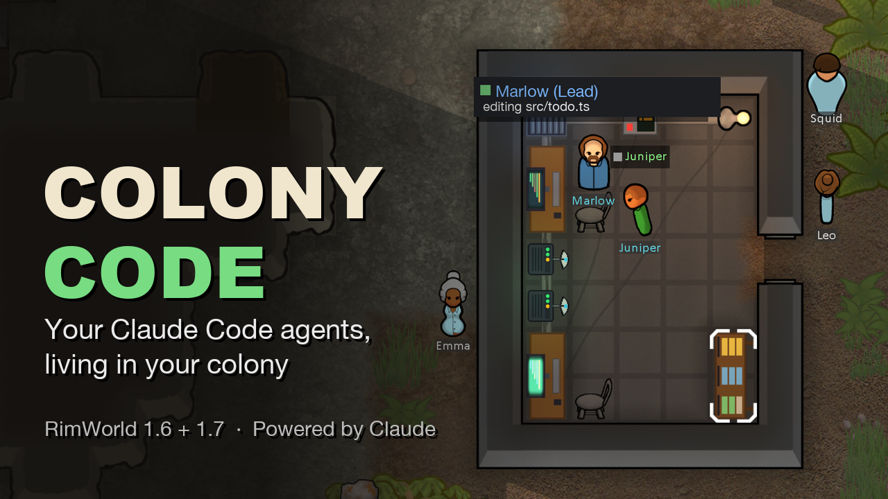

# Colony Code



**Your Claude Code agents, living in your RimWorld colony.** Powered by Claude.

Colony Code turns the Claude Code sessions you run on your own computer into remote workers in your
colony. They code at their desks while your agents work, walk to the decision terminal when Claude
needs an answer, and celebrate when a goal ships. You can send goals, answer questions and review
code without leaving the game.

## Features

- **A remote office from day one.** A new colony starts with a small, powered office and two remote
  workers, Marlow and Juniper, already at their desks.
- **Remote workers.** Friendly residents who live in your colony for good. They need no food or
  sleep, and they don't take orders. Each powered agent desk you build brings one more.
- **See the real work.** Workers type, read and run tests at their desks, the monitor glows by
  state, and a status line above each worker says what their agent is doing.
- **Decisions as letters.** When Claude asks you something, a letter arrives and the worker waits at
  the decision terminal until you answer.
- **Task board.** To do, In progress and Done columns that fill up as you and Claude work.
- **Code review.** Look at the changes and choose Merge, Request changes or Reject.
- **Console.** Press `\` to give Claude a goal or message one of your agents.
- **And more:** agent cards, a journal of finished goals, token usage, and a small celebration
  whenever a goal ships.

## Install

You need **RimWorld 1.6 or 1.7** and **[Claude Code](https://claude.com/claude-code)**, signed in with
your own account. All usage counts against your own plan. Biotech is optional, and no other mods are
needed.

1. **Get the mod.** Subscribe on the Steam Workshop, or download the mod zip from
   [Releases](https://github.com/Tw1stedGene/colony-code/releases) and unzip it into your RimWorld
   `Mods` folder.
2. **Enable it.** In RimWorld, open **Mods**, turn on **Colony Code**, and restart when asked.
3. **Add the plugin to Claude Code.** In Claude Code, run:
   ```
   /plugin install colony-code --marketplace Tw1stedGene/colony-code
   ```

## Getting started

1. **Start a new colony** (any industrial start, such as Crashlanded). Your remote office is close
   to where your colonists land, and a letter tells you it's online.
2. **Open Claude Code** in any project folder. Its status line shows **RimWorld ● connected**.
3. **Work as usual.** Whatever you ask Claude in the terminal, Marlow works on at their desk. Helpers
   Claude starts take the other desks.
4. **Or give work from the game.** Press `\` to open the console and type a goal, or use **+ Add task**
   on the task board.
5. **Answer letters** when a worker comes to the decision terminal.

**Want more workers?** Build more **agent desks** (Architect → Misc). Each powered desk brings one
remote worker. **Server racks** raise the limit: 3 workers, plus 2 for each powered rack.

**Settings** (Options → Mod settings → Colony Code):
- **Starting office:** small (2 desks), large (4 desks), or none.
- **Colony moods:** thoughts when a goal ships or tests fail.
- **Skills:** Intellectual XP for workers.
- **Speech:** speech bubbles over workers.

**Already have a colony?** You can add Colony Code to an existing save. The starting office only
appears in new games, so research **Networking** and build the desks yourself.

## Your account stays private

- You sign in **in Claude Code**. The mod never sees your login, API keys or billing.
- The game never runs commands on your computer. It only shows what Claude Code is doing and
  passes your answers back.
- The connection between the game and Claude Code stays on your own computer, and web pages and other
  programs can't use it.
- Code is merged or deleted only when you click, and nothing is ever pushed anywhere.

## Troubleshooting

- **Claude Code says "RimWorld not running".** Load a colony in RimWorld first; the main menu isn't
  enough. Claude Code reconnects on its own within a few seconds.
- **Permission prompts stay in the terminal.** If your Claude Code is managed by your organization,
  only an administrator can let the plugin answer permission prompts. Everything else still works,
  and Claude's questions still arrive as letters.
- **A task waits with "Waiting for Claude Code".** No Claude Code session is open. The task goes to
  the next one you start.
- **Workers stand around.** That's normal when no agent is working. They go back to their desks as
  soon as Claude starts.

## Compatibility

- Works with RimWorld 1.6 and 1.7, with or without DLCs.
- **Not compatible with the Multiplayer mod.**
- Safe to add to an existing save. As with most mods, back up your save before removing it from a
  colony in progress.

## Support

Found a bug or have an idea? [Open an issue](https://github.com/Tw1stedGene/colony-code/issues).

Colony Code is free. If it makes your colony, or your workday, better, you can
[buy me a coffee](https://buymeacoffee.com/tw1stedgene).

Want to help build it? See [CONTRIBUTING.md](CONTRIBUTING.md).

## License

MIT, see [LICENSE](LICENSE). 

Colony Code is a fan project. It is not affiliated with, endorsed by or sponsored by Anthropic or
Ludeon Studios. Claude and Claude Code are trademarks of Anthropic.
